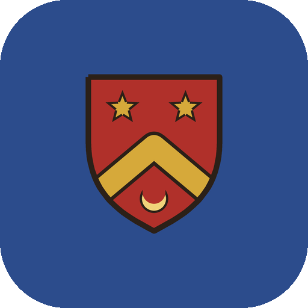

<p align="center"></p>

# Party of Two · Отряд из двух

A date app for two in the look of an illuminated manuscript. The couple is a party of heroes, a date is a
quest out in the real world, and the phone is the game master. Part of [Stillcraft](https://bigdevwhale.github.io/stillcraft/).

Приложение для свиданий в эстетике иллюминированной рукописи. Пара — отряд героев, свидание — квест в
настоящем мире, а телефон — мастер игры.

- **Arms** — each hero answers five questions alone; where you agree the shield is one, where you don't it splits.
- **Quests** — a weekly board, 88 quests in eight schools, three serial tales, quests of your own.
- **On the road** — secret objectives, the d20 of fate, wandering encounters, campfire questions, the spell of silence.
- **Home** — guess each other's secret, write the chapter, keep a trophy, raise a tower on your island.
- **Long game** — 20 levels, growing arms, school ranks, 31 deeds, dragons to slay, the raven's errand, sealed letters.

Offline. No account, no internet permission.

## Build

```
./gradlew testDebugUnitTest assembleDebug
./gradlew assembleDebug -Pdemo            # app.party.demo with a year of quests
./gradlew testDebugUnitTest -Prender --tests '*RenderArtScreens*'   # screens to app/build/art
python tools/strings.py app/src/main/res  # strings from one table
python tools/icon.py                      # launcher icon
```

Lore lives in `app/src/main/assets/lore/*.tsv`; see [docs/LORE.md](docs/LORE.md).
