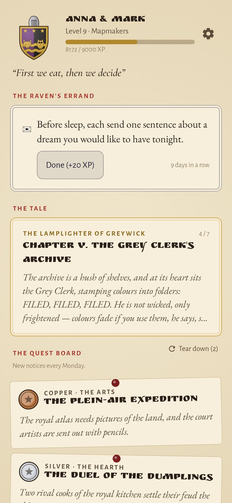
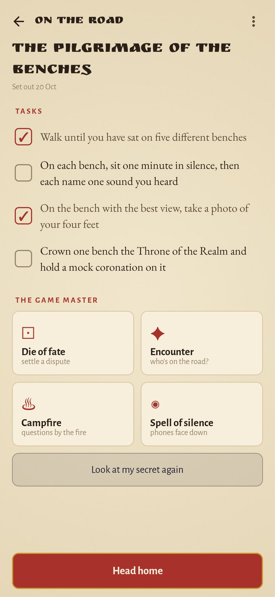
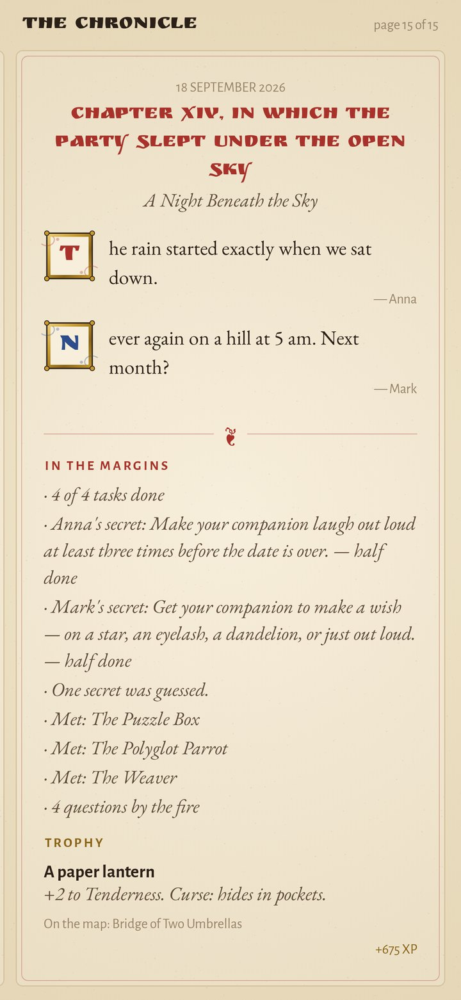
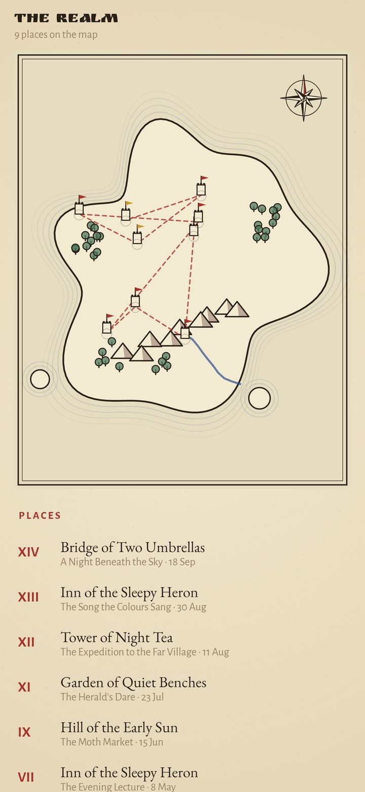
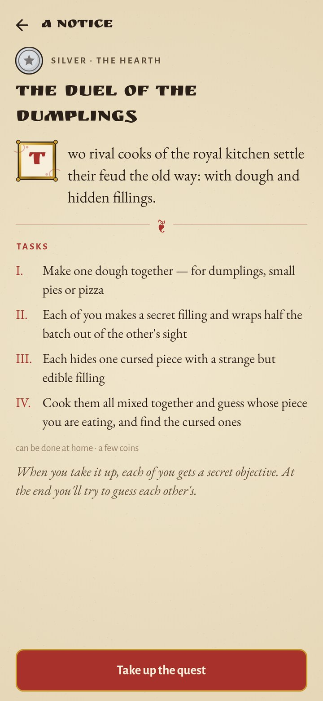
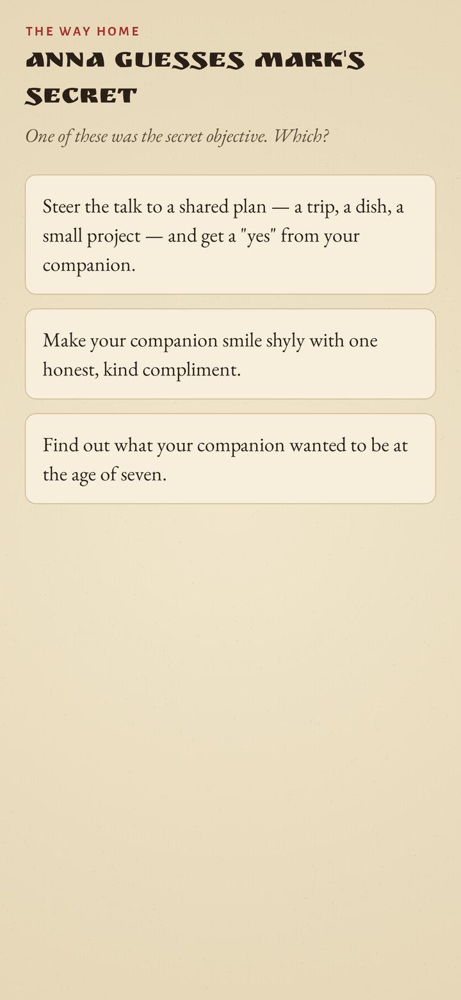
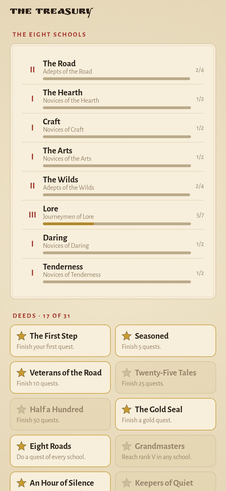
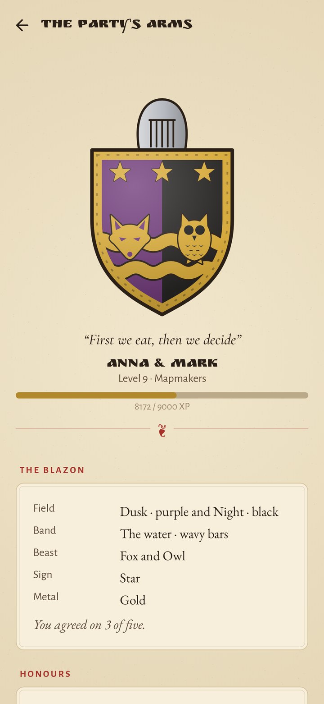

<div align="center">


# Party of Two

### Every date is a quest. The two of you are the party.

*Dates slide into the same café and the same scrolling. Party of Two turns them back into adventures. The two of you found a party with a coat of arms of your own, take quests from the tavern board out into the real world, and the phone plays game master: it deals each of you a secret objective, sends wandering encounters, rolls the die of fate and writes everything into an illuminated chronicle that grows for years. Free, no ads, no account, no internet permission.*

[](https://github.com/bigdevwhale/party/actions/workflows/android.yml)
[](https://github.com/bigdevwhale/party/releases/latest)


[](LICENSE)

**English** · [Русский](README.ru.md) · [Changelog](CHANGELOG.md)

   

</div>

---

## The idea

Couples stop dating each other long before they stop loving each other: evenings turn into "what do you want to do?" and the same three places. Games fix that. They give you a reason to go somewhere new, a small secret to keep, and a story to tell afterwards. Party of Two is a tabletop RPG where the table is your town.

- **One phone, two heroes.** The phone is passed between you. Secrets and letters are read by one of you while the other looks away; everything else you look at together.
- **Real things, fantasy words.** A walk is a patrol of the lantern road, a supper is a feast at the tavern, a box room you never clear out is a dragon with eight hit points. The real activity is always plain to see.
- **Nobody is rated.** Nothing ever asks you to score or describe each other. The game counts only what you did together.

## A quest, step by step

1. **The board.** Three notices every Monday, one copper (an hour or two), one silver (an evening), one gold (a day to remember), from three different schools. Tear them down twice a week if none fits, open the book of all 88, or write a quest of your own.
2. **The oath.** Both thumbs on the wax seal at once; the gold ring fills and the quest begins.
3. **Letters.** If either of you wrote one since the last quest, the raven brings it now, sealed with your arms.
4. **Secret objectives.** Each of you takes the phone alone and holds the card to read a secret: make them laugh out loud three times, find out what they wanted to be at seven, take a photo of them laughing without being caught. 110 of them.
5. **On the road.** Tick off the quest's tasks. The game master's tools are at hand:
   - **the die of fate**, a d20 for every dispute; a natural 20 brings a boon, a 1 a mishap;
   - **encounters**: a riddling sphinx, a wandering minstrel, a fog to walk through blind. When you haven't looked at the phone for twenty minutes, one is waiting on the road;
   - **the campfire**, questions for both of you, one log at a time;
   - **the spell of silence**: lay the phone face down for 30 to 90 minutes. Pick it up early and the seal cracks, and the chronicle remembers.
6. **The way home.** Each of you guesses the other's secret from three, and owns up whether yours came off.
7. **The chapter.** Each writes a line or two. Photograph a trophy (a ticket, a pebble, a leaf) and it gets lore of its own: *"+2 to Wanderlust. Curse: always ends up on the windowsill."* Tap your island to raise a tower where it happened.
8. **The reckoning.** Experience line by line, a new level, a new rank, new deeds.

## Built to last for years

| | What keeps you coming back | How |
|---|---|---|
| 🛡️ | **Arms of your own** | Each of you answers five questions alone: your hour, your road, your beast, your sign, gold or silver. Where you agree the shield is one; where you don't it splits and shows you both, as heralds once joined two houses. 8 beasts, 8 signs, 5 bands, 5 fields. |
| 👑 | **Arms that grow** | Twenty levels, about a year of weekly dates. A golden border at level 5, a helm at 8, mantling at 12, a crown at 16, a laurel wreath at 20, and a star for every tale told. |
| 📜 | **Three tales** | Serial stories of seven chapters: *The Lamplighter of Greywick*, whose colours ran away; *The Restless Map*, which redraws itself; *The Stone and the Star*, two lovers you set free. Every chapter is a date with its own tasks, ends on a small cliffhanger, and the next one is posted three days later. |
| 🏰 | **Eight schools** | The Road, the Hearth, Craft, the Arts, the Wilds, Lore, Daring and Tenderness, each with ranks from Novices to Grandmasters. The book of quests shows which ones you have done; when everything is done, the oldest come back. |
| 🗺️ | **An island of your own** | Its coastline, mountains, woods and river are drawn from your party's seed the day you found it. Each quest raises a tower on it, joined by a dashed road in the order you lived them. |
| 📖 | **The chronicle** | Every quest becomes a chapter with illuminated initials: "Chapter VII, in which the party lost its way in the fog". Your lines, the secrets in the margins, the encounters, the rolls of 20 and 1, the seal, the trophy. |
| ⭐ | **31 deeds** | Mind Readers, Natural One, Itchy Fingers, Four Seasons, Past Midnight, Dragonslayers and more. |
| 🐉 | **The party's dragons** | Things you both keep putting off, with a name, hit points and a portrait. Every small step is a strike; slain dragons go into the bestiary. |
| 🐦‍⬛ | **The raven** | A small errand every day, even when you're apart: send each other the most dragon-like thing you see, look at the moon at the same time. Keep the streak going. |
| ✉️ | **Sealed letters** | Write to the other one any day; the raven keeps the letter until the next quest begins. |

All the text lives in `app/src/main/assets/lore`: 88 quests, 21 chapters, 110 secrets, 90 encounters, 100 campfire questions, 70 errands and 60 fates, in English and Russian.

## Privacy

No account, no cloud, no analytics, no internet permission. Trophies are photographed with your phone's own camera app. Everything stays on the phone; the chronicle can be saved to a file.

## Screenshots

   

## Build

```bash
./gradlew assembleDebug                 # app.party.dev
./gradlew assembleDebug -Pdemo          # app.party.demo, a made-up year of quests
./gradlew testDebugUnitTest             # unit tests: the lore, the board, campaigns, levels, deeds, backups
./gradlew testDebugUnitTest -Prender --tests '*RenderArtScreens*'   # every screen to app/build/art, EN and RU
python tools/strings.py app/src/main/res       # both languages' strings from one table
python tools/icon.py                           # the launcher icon and docs/logo.png
```

The lore format is described in [docs/LORE.md](docs/LORE.md): one line per entry, seven tab-separated columns, Russian gender forms marked `{companion's|forms}` and `[reader's|forms]`. Kotlin, Jetpack Compose, Room, DataStore. The arms, beasts, wax seals, the d20, the dragons and the island are drawn in code on a Compose canvas. Fonts: Ruslan Display, EB Garamond, Cormorant and Alegreya Sans (OFL).

Part of [Stillcraft](https://bigdevwhale.github.io/stillcraft/apps/party/). MIT licence.
