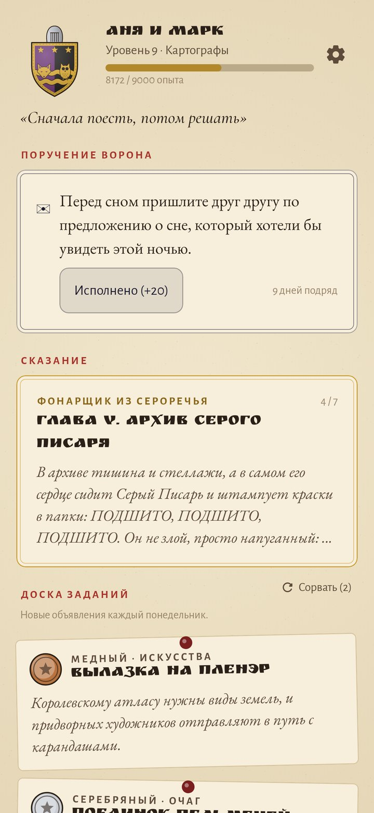
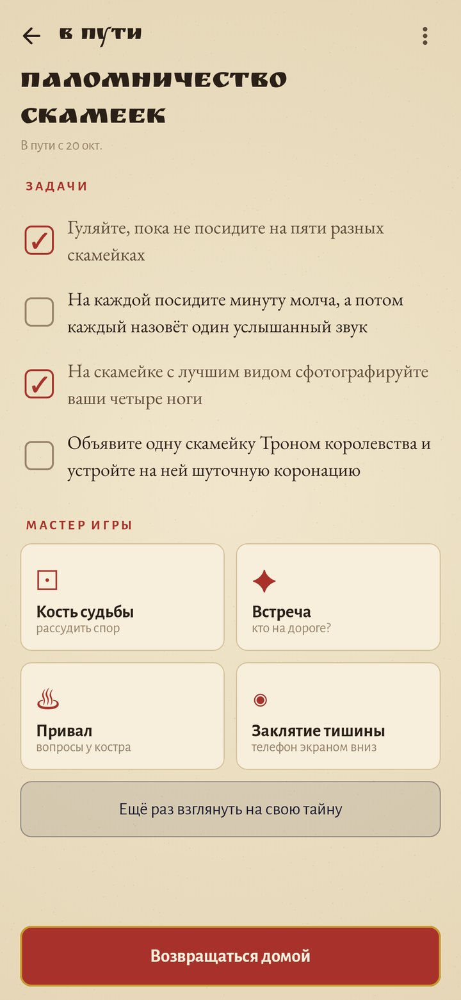
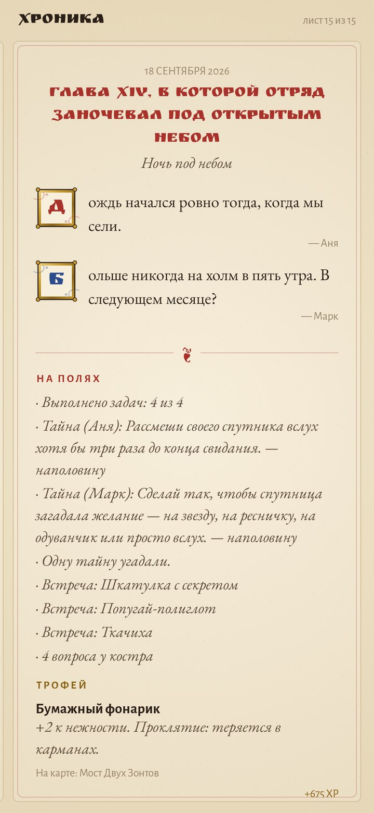
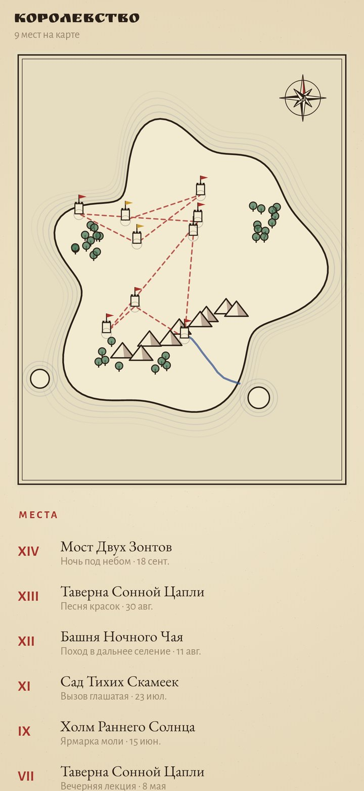
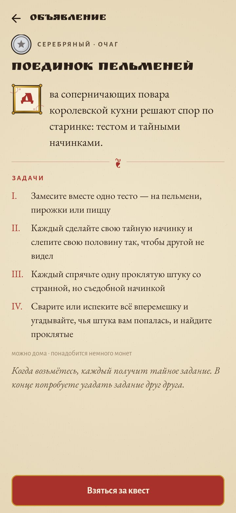
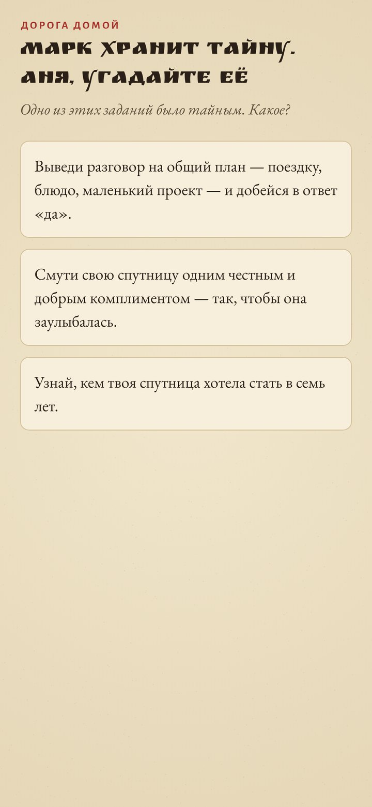
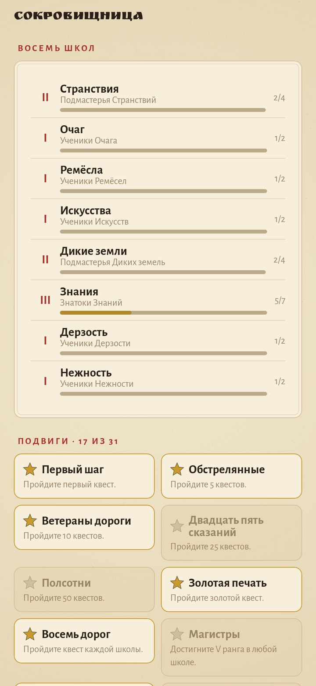
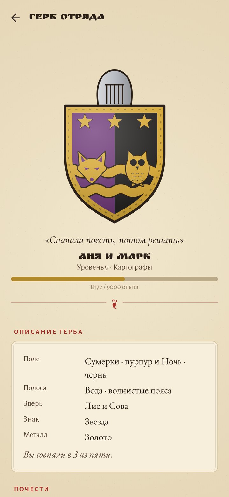

<div align="center">


# Отряд из двух

### Каждое свидание — квест. Вы двое — отряд.

*Свидания сползают в одно и то же кафе и в одни и те же ленты. «Отряд из двух» снова делает их приключениями. Вы вдвоём основываете отряд со своим гербом, берёте квесты с доски в таверне и выходите с ними в настоящий мир, а телефон становится мастером игры: раздаёт каждому тайное задание, посылает встречи на дороге, бросает кость судьбы и записывает всё в иллюминированную хронику, которая растёт годами. Бесплатно, без рекламы, без аккаунта и без доступа в интернет.*

[](https://github.com/bigdevwhale/party/actions/workflows/android.yml)
[](https://github.com/bigdevwhale/party/releases/latest)


[](LICENSE)

[English](README.md) · **Русский** · [Изменения](CHANGELOG.md)

   

</div>

---

## Идея

Пары перестают ходить друг к другу на свидания задолго до того, как перестают любить: вечер превращается в «ну а ты чего хочешь?» и в три одних и тех же места. Игры это лечат: дают повод пойти туда, где вы не были, маленькую тайну и историю, которую потом хочется рассказывать. «Отряд из двух» — настольная ролевая игра, в которой стол — это ваш город.

- **Один телефон, два героя.** Телефон передаётся из рук в руки. Тайны и письма читает один, пока второй отворачивается; всё остальное вы смотрите вместе.
- **Настоящие дела, сказочные слова.** Прогулка — дозор фонарей, ужин — пир в таверне, кладовка, которую вы годами не разбираете, — дракон с восемью жизнями. Что делать на самом деле, всегда понятно с первого взгляда.
- **Никого не оценивают.** Игра никогда не просит ставить друг другу баллы или описывать друг друга. Считается только то, что вы сделали вместе.

## Квест по шагам

1. **Доска.** Каждый понедельник три объявления из трёх разных школ: медное (час-другой), серебряное (вечер) и золотое (день, который запомнится). Если ничего не подошло, их можно сорвать дважды в неделю, открыть книгу всех 88 квестов или написать свой.
2. **Клятва.** Оба кладут большие пальцы на сургучную печать, золотое кольцо заполняется — квест начался.
3. **Письма.** Если кто-то написал письмо с прошлого квеста, ворон приносит его сейчас, запечатанным вашим гербом.
4. **Тайные задания.** Каждый берёт телефон один и удерживает карточку, чтобы прочесть тайну: трижды рассмешить вслух, узнать, кем второй хотел стать в семь лет, незаметно сфотографировать, как он смеётся. Всего их 110.
5. **В пути.** Отмечайте задачи квеста. Инструменты мастера под рукой:
   - **кость судьбы** — d20 для любого спора; двадцатка приносит милость, единица — злоключение;
   - **встречи**: сфинкс с загадкой, бродячий менестрель, туман, через который идёшь вслепую. Если двадцать минут не заглядывать в телефон, встреча уже ждёт на дороге;
   - **костёр** — вопросы для обоих, полено за поленом;
   - **заклятие тишины**: телефон лежит экраном вниз от 30 до 90 минут. Поднимете раньше — печать треснет, и хроника это запомнит.
6. **Дорога домой.** Каждый угадывает тайну другого из трёх вариантов и признаётся, получилась ли своя.
7. **Глава.** Каждый пишет строку-другую. Трофей с дороги (билет, камешек, листок) можно сфотографировать, и у него появятся свойства: *«+2 к жажде странствий. Проклятие: всегда оказывается на подоконнике»*. Коснитесь острова — там, где всё было, встанет башня.
8. **Итоги.** Опыт по пунктам, новый уровень, новый ранг, новые подвиги.

## Чтобы хватило на годы

| | Что заставляет возвращаться | Как это устроено |
|---|---|---|
| 🛡️ | **Свой герб** | Каждый сам отвечает на пять вопросов: ваш час, ваша дорога, ваш зверь, знак, золото или серебро. Где вы совпали, щит единый; где разошлись — он рассекается и показывает обоих, как герольды когда-то соединяли два рода. 8 зверей, 8 знаков, 5 полос, 5 полей. |
| 👑 | **Герб растёт** | Двадцать уровней — примерно год свиданий раз в неделю. Золотая кайма на 5-м, шлем на 8-м, намёт на 12-м, корона на 16-м, лавровый венок на 20-м и звезда за каждое рассказанное сказание. |
| 📜 | **Три сказания** | Истории по семь глав: «Фонарщик из Сероречья», от которого сбежали краски; «Непоседливая карта», что перерисовывает себя; «Камень и Звезда» — двое влюблённых, которых вы расколдуете. Каждая глава — свидание со своими задачами, заканчивается на интриге, а следующая появляется через три дня. |
| 🏰 | **Восемь школ** | Странствия, Очаг, Ремёсла, Искусства, Дикие земли, Знания, Дерзость и Нежность, в каждой ранги от Учеников до Магистров. Книга квестов показывает, что уже пройдено; когда пройдено всё, возвращаются самые давние. |
| 🗺️ | **Свой остров** | Берега, горы, леса и река рисуются из зерна вашего отряда в день основания. Каждый квест ставит на острове башню, а пунктирная дорога соединяет их в том порядке, в каком вы их прожили. |
| 📖 | **Хроника** | Каждый квест становится главой с буквицами: «Глава VII, в которой отряд заблудился в тумане». Ваши строки, тайны на полях, встречи, выпавшие 20 и 1, печать, трофей. |
| ⭐ | **31 подвиг** | Читающие мысли, Чистая единица, Нетерпеливые пальцы, Четыре времени года, После полуночи, Драконоборцы и другие. |
| 🐉 | **Драконы отряда** | Дела, которые вы оба откладываете, — с именем, жизнями и портретом. Каждый маленький шаг — удар; поверженные драконы уходят в бестиарий. |
| 🐦‍⬛ | **Ворон** | Каждый день маленькое поручение, даже если вы порознь: прислать друг другу самое драконье, что увидите, одновременно посмотреть на луну. Не прерывайте серию. |
| ✉️ | **Письма под печатью** | Напишите второму в любой день — ворон сохранит письмо до начала следующего квеста. |

Весь текст лежит в `app/src/main/assets/lore`: 88 квестов, 21 глава сказаний, 110 тайн, 90 встреч, 100 вопросов у костра, 70 поручений и 60 судеб — на русском и английском.

## Приватность

Без аккаунта, облака, аналитики и доступа в интернет. Трофеи снимаются обычной камерой телефона. Всё хранится только на телефоне; хронику можно сохранить в файл.

## Скриншоты

   

## Сборка

```bash
./gradlew assembleDebug                 # app.party.dev
./gradlew assembleDebug -Pdemo          # app.party.demo, придуманный год квестов
./gradlew testDebugUnitTest             # тесты: лор, доска, сказания, уровни, подвиги, копии
./gradlew testDebugUnitTest -Prender --tests '*RenderArtScreens*'   # все экраны в app/build/art, EN и RU
python tools/strings.py app/src/main/res       # строки обоих языков из одной таблицы
python tools/icon.py                           # иконка и docs/logo.png
```

Формат лора описан в [docs/LORE.md](docs/LORE.md): одна запись на строку, семь колонок через табуляцию, русские формы по роду помечены `{формы|спутника}` и `[формы|читающего]`. Kotlin, Jetpack Compose, Room, DataStore. Гербы, звери, сургучные печати, кость d20, драконы и остров нарисованы кодом на канвасе Compose. Шрифты: Ruslan Display, EB Garamond, Cormorant и Alegreya Sans (OFL).

Часть [Stillcraft](https://bigdevwhale.github.io/stillcraft/apps/party/). Лицензия MIT.
